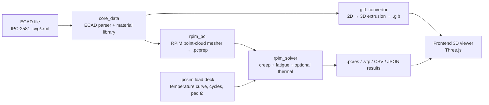
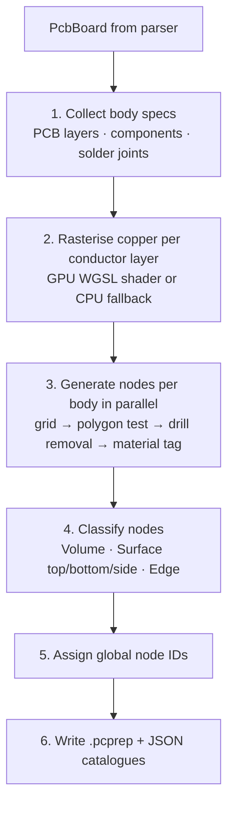
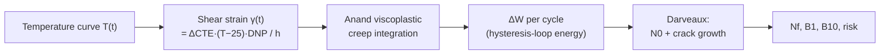

# ElectroniX — Solder Joint Fatigue Simulation

**ElectroniX** predicts how long the solder joints on a printed circuit board (PCB) will survive repeated
heating and cooling. You give it your board design (an IPC-2581 ECAD file) and a temperature cycle
(for example JEDEC −55 °C ↔ +125 °C). It gives back, for every solder joint on the board, an estimated
number of cycles to failure, a risk rating, and colour maps you can inspect in 3D.

It is a desktop application (Tauri + React/Three.js) backed by three standalone, scriptable Rust
command-line tools that can also be run headless.

> **Contents**
> 1. [What problem does it solve? (plain-language overview)](#1-what-problem-does-it-solve)
> 2. [System architecture & data flow](#2-system-architecture--data-flow)
> 3. [ECAD parser (IPC-2581 → board model)](#3-ecad-parser)
> 4. [From 2D to 3D (geometry extrusion & GLB export)](#4-from-2d-to-3d)
> 5. [RPIM meshing (the point cloud)](#5-rpim-meshing)
> 6. [Empirical relations used for meshing](#6-empirical-relations-used-for-meshing)
> 7. [Thermal solver](#7-thermal-solver)
> 8. [Solder fatigue solver (creep + Darveaux)](#8-solder-fatigue-solver)
> 9. [File formats](#9-file-formats)
> 10. [Running it](#10-running-it)
> 11. [Validation](#11-validation)
> 12. [Assumptions & known limitations](#12-assumptions--known-limitations)
> 13. [References](#13-references)

---

## 1. What problem does it solve?

### The short version

Electronics warm up and cool down — every day, every flight, every cold start. Different parts of a
board grow and shrink by different amounts when the temperature changes:

* the **PCB** (fibre-glass, "FR-4") expands at roughly **14 ppm per °C**;
* a **chip package** (epoxy mould compound) expands at roughly **12 ppm per °C**.

That tiny difference means the chip and the board try to slide against each other. The only thing
holding them together is a few hundred small blobs of **solder**. Each heating/cooling cycle bends and
stretches every solder joint a little. Solder is soft, so it slowly *creeps* (flows like very stiff
putty), and each cycle leaves behind a bit of permanent damage — a tiny crack that grows, cycle after
cycle, until the joint finally breaks and the product stops working. This is **solder fatigue**.

Two intuitions explain almost every result you will see:

| Intuition | Why |
|---|---|
| **Joints far from the centre of a chip fail first.** | The farther a joint is from the chip's centre (the "neutral point"), the more the board and chip slide apart *at that joint*. Corner balls of a big BGA are the weakest. |
| **Bigger temperature swings and taller/shorter joints change life dramatically.** | Damage grows roughly with swing size and with how little solder height there is to absorb the movement. |

### What ElectroniX does for you

1. **Reads** your ECAD file (IPC-2581) and understands the board: layers, copper, components, pads, vias.
2. **Builds a 3D model** from that 2D layout so you can see it and so the solver has real geometry.
3. **Meshes** it with a *point cloud* (no triangles/tetrahedra needed — this is the "RPIM" meshless approach).
4. **Applies a temperature cycle** (JEDEC, IPC-9701A, AEC-Q100, MIL-STD-810H, ECSS, IEC, or your own curve).
5. **Simulates how each joint creeps** (Anand viscoplastic model) and measures the energy dissipated per cycle.
6. **Converts that energy into life** (Darveaux model) and ranks every joint: `SAFE`, `MARGINAL`, `AT_RISK`, `CRITICAL`.

---

## 2. System architecture & data flow



### Repository layout

The repo is a Tauri workspace that pulls the engine components in as git submodules.

| Path | Role |
|---|---|
| `core_data/` | Shared library: IPC-2581 parser, board data model, canonical 5-material library. Used by every Rust tool so material values never drift. |
| `gltf_convertor/` | CLI: `.cvg` → `.glb` (3D visual model with face tagging). |
| `rpim_pc/` | CLI: `.cvg` → `.pcprep` (RPIM point-cloud mesh + materials + solver settings). |
| `rpim_solver/` | CLI: `.pcsim`/`.pcprep` → creep, fatigue, (optional) thermal results. |
| `frontend/` | React 18 + TypeScript + Three.js GUI (3D viewer, simulation browser, material library, results). |
| `src-tauri/` | Tauri 2 shell: manages sessions, launches the three CLIs as sidecars, streams logs, reads `.pcres`. |
| `validation/` | Validation cases (Darveaux 2000 PBGA-256) and tooling. |

### Session layout

Every project lives in a session folder (`%AppData%\ElectroniX\<uuid>\` on Windows,
`~/Library/Application Support/ElectroniX/<uuid>/` on macOS, `~/.local/share/ElectroniX/<uuid>/` on Linux):

```
<session_uuid>/
├── models/          <board>.glb
├── point_cloud/     <board>.pcprep, rpim_pc.log
└── simulation/
    └── <SimName>/   <SimName>.pcsim, solver outputs, rpim_solver.log
```

The UUID-keyed layout maps directly onto object storage (S3/GCS) if the product is later hosted.

---

## 3. ECAD parser

**Code:** [`core_data/src/parser.rs`](core_data/src/parser.rs), [`core_data/src/model.rs`](core_data/src/model.rs)
**Input:** IPC-2581 XML (`.cvg` or `.xml`, namespace `http://webstds.ipc.org/2581`)
**Output:** an in-memory `PcbBoard`

### In layman's terms

IPC-2581 is an industry "everything about the board" file. The parser reads it like a bill of
materials *plus* a blueprint: it learns the board's shape, the stack of layers and their thicknesses,
each component's footprint and where it is placed, every pad, trace, copper area and hole — and which
net each pin belongs to. From the pads it then works out where every **solder joint** is.

### Parsing pipeline

`parse_ipc2581()` runs these steps in order:

| # | Step | What is read | Notes |
|---|---|---|---|
| 1 | **Shape dictionaries** | `DictionaryStandard/EntryStandard` and `DictionaryUser/EntryUser` | Circle, RectCenter, Square, Oval/Oblong, Diamond, Hexagon, Octagon, Triangle, Contour → `PadShape`. User-defined shapes use their polygon outlines. |
| 2 | **Layers** | `Layer` (function, side, polarity) | Functions mapped to Conductor/PLANE, SolderMask, Paste, Silkscreen, Other. Reads the file's unit (`CadHeader@units`). |
| 3 | **Stackup** | `Stackup/StackupLayer` | Thickness, material type, dielectric constant are attached to each layer. |
| 4 | **Nets** | `LogicalNet/LogicalNetPin` | Builds `(component, pin) → net` map. |
| 5 | **Board outline** | `Step/Profile` polygon + `Cutout`s | Lines and arcs (`PolyStepSegment`, `PolyStepCurve`). |
| 6 | **Packages** | `Step/Package` | Body outline polygon, bounding box, `LandPattern/Pad` locations and shape references. |
| 7 | **Components** | `Step/Component` | Placement (x, y), rotation, mirror, mounting side, height, and transformed outline in *board* coordinates. |
| 8 | **Copper features** | `LayerFeature/Set/Features` | `Polyline`/`Line` → traces with width; `Contour` → copper pours. |
| 9 | **Holes / vias** | `Hole` (`platingStatus`) | Plated/via → through-hole; otherwise non-plated. |
| 10 | **Solder joints** | derived from component pins + pad shape | See below. |

### Geometry details worth knowing

* **Arcs** (`PolyStepCurve`) are tessellated into short straight segments (8 per arc for pad/pour
  polygons, 12 per arc for board and package outlines) using the centre point, start/end angle and
  clockwise flag.
* **Placement transform** applied to every package outline and pad:
  `x' = cx + (m·lx)·cos θ − ly·sin θ`, `y' = cy + (m·lx)·sin θ + ly·cos θ`, where `m = −1` for a
  mirrored (bottom-side) component.
* **Units**: the model keeps *file units* (INCH in the supported files). `PcbBoard::to_mm()` returns the
  25.4 scale factor, so every downstream stage converts to millimetres explicitly.
* **Total thickness** = sum of all stackup layer thicknesses.

### How a solder joint is derived

For each component pin the parser creates a `SolderJoint`:

* **Position** — the pin's board-space (x, y).
* **Pad shape** — looked up from the pad's `StandardPrimitiveRef` in the shape dictionary (falls back to
  a Ø0.030 in circle if unknown).
* **Paste layer** — top or bottom paste layer according to the mounting side.
* **Paste thickness** — 0.0047 in (≈ 0.12 mm), the typical deposit after reflow.
* **Mask opening** — pad grown by 0.0025 in per side.
* **Solder volume** — `pad area × paste thickness`.

### Material library (single source of truth)

[`core_data/src/material.rs`](core_data/src/material.rs) defines five canonical materials with stable IDs.
Both the mesher and the solver read the same table.

| ID | Material | Category | E (GPa) | CTE x/y/z (ppm/K) | k (W/m·K) | Cp (J/kg·K) | ρ (kg/m³) |
|---|---|---|---|---|---|---|---|
| 1 | FR4 | dielectric | 24 / 24 / 8 | 14 / 14 / 55 | 0.3 | 1200 | 1850 |
| 2 | Copper | conductor | 120 | 17 | 385 | 385 | 8960 |
| 3 | ConformalCoat | dielectric | 3.5 | 60 | 0.2 | 1000 | 1200 |
| 4 | SAC305 | solder | 51 | 21 | 58 | 220 | 7370 |
| 5 | EpoxyMoldCompound | component | 25 (z: 25) | 12 / 12 / 40 | 0.8 | 800 | 1800 |

SAC305 additionally carries the Anand viscoplastic and Darveaux crack-growth constants
(see [§8](#8-solder-fatigue-solver)).

---

## 4. From 2D to 3D

**Code:** [`gltf_convertor/src/export_gltf.rs`](gltf_convertor/src/export_gltf.rs),
[`gltf_convertor/src/mesh_builder.rs`](gltf_convertor/src/mesh_builder.rs)
**Output:** a binary glTF (`.glb`) 3D model for the viewer.

### In layman's terms

An ECAD file is flat: outlines drawn on a plane, with a thickness and a height written next to them.
ElectroniX makes it three-dimensional the same way a cookie cutter and dough would: **take each 2D
outline and push it up (extrude) by its real-world thickness or height.** The board becomes a slab,
each chip a block standing on it, each pad a small puck.

### Z-axis convention

```
 z = +h_comp  ┌──────────┐   Top-side component   [0, +h]
 z =  0 ──────┴──────────┴─────────  TOP of PCB
              │   PCB    │            substrate:    [−T, 0]
 z = −T ──────┬──────────┬─────────  BOTTOM of PCB
              └──────────┘   Bottom-side component [−T−h, −T]
```

`T` is the total stackup thickness. Top-mounted parts sit above `z = 0`; bottom-mounted parts hang
below `z = −T`.

### Step by step

| Object | 2D source | Extrusion in Z | Notes |
|---|---|---|---|
| **PCB substrate** (`FR4_Substrate`) | Board outline contour (arcs tessellated, 12 pts/arc) | `[−T, 0]` | |
| **Component** (`Component_<ref>`) | Package outline already transformed to board coordinates (rotation + mirror + translation). Fallback: rotated bounding-box rectangle from width × height. | Top `[0, h]`, bottom `[−T−h, −T]` | Components with no outline and body < 0.05 mm are skipped. |
| **Solder joint** (`Solder_<ref>_<pin>`) | Pad shape: circle (12-gon), square, rect/oblong (rotated), polygon | Top `[0, 0.12 mm]`, bottom `[−T−0.12, −T]` | 0.12 mm = typical paste deposit. |

**Height sanitising.** Some ECAD tools write a sentinel height (e.g. `9.999`) for "unknown".
Anything above **25 mm** is treated as a sentinel and replaced by **0.5 mm**; zero-height parts are
floored at **0.1 mm** so they remain visible. (A genuine 34.8 mm heatsink stays at its real height.)

### Turning a 2D polygon into a 3D solid

`MeshData::extrude_polygon()` builds a closed prism from any simple polygon:

1. **Triangulate** the outline with the *ear-clipping* algorithm (`earcut`) to fill the polygon.
2. **Top cap** — those triangles at `z_top`, normal `+Z`, tagged `_FACE_ID = 1`.
3. **Bottom cap** — the same triangles at `z_bot` with reversed winding, normal `−Z`, `_FACE_ID = 2`.
4. **Side walls** — one quad (2 triangles) per outline edge, outward normal
   `(dy, −dx, 0)/|edge|`, `_FACE_ID = 3`.

The custom per-vertex `_FACE_ID` attribute lets the 3D viewer pick top/bottom/side faces — the same
face concept (`S_top`, `S_bot`, `S_side`) reappears in the mesh and as thermal boundary conditions.

### GLB packaging

Positions, normals, face IDs and indices for each body are packed into one binary buffer with
accessor/bufferView metadata, and wrapped as `glTF` v2 (JSON chunk + BIN chunk, 4-byte aligned).
Default colours: substrate dark green, components dark grey, solder silver-grey.

---

## 5. RPIM meshing

**Code:** [`rpim_pc/src/rpim_gen.rs`](rpim_pc/src/rpim_gen.rs), [`rpim_pc/src/config.rs`](rpim_pc/src/config.rs),
[`rpim_pc/src/writer.rs`](rpim_pc/src/writer.rs), [`rpim_pc/src/gpu_raster.rs`](rpim_pc/src/gpu_raster.rs)
**Output:** `<base>.pcprep` (point cloud + materials + solver settings), `<base>_rpim_materials.json`,
`<base>_rpim_config.json`.

### In layman's terms

Traditional simulation chops a part into thousands of tiny connected bricks (a *mesh*). That is
fragile for a board with 1 µm copper foils next to 1.6 mm of fibre-glass and thousands of tiny
solder balls — the bricks become badly shaped. **RPIM** (Radial Point Interpolation Method) skips the
bricks. Instead we **scatter points** (nodes) through every body and let each point "feel" its
neighbours through a smooth mathematical blending function. No element connectivity, no mesh
repair, and layers of wildly different thickness can coexist.

Think of it as *pins on a map* instead of *a jigsaw puzzle*: points only need to know who is nearby.

### Pipeline



### 5.1 Bodies

| Body type | Name | One body per… | Material |
|---|---|---|---|
| PCB layer | `PCB_<layer>` | each IPC-2581 stackup layer with thickness ≥ 0.1 µm | FR4 base; copper where copper exists (conductors) |
| Component | `comp_<ref>` | each placed component | Epoxy mould compound |
| Solder joint | `solder_<ref>_<pin>` | each pin/pad | SAC305 |

Body names are the contract between stages: the solver recognises `PCB_*`, `comp_*` and `solder_*`
purely by prefix, and parses the reference designator and pin from `solder_<ref>_<pin>`.

### 5.2 Node generation for one body

1. Take the body's 2D **footprint polygon** and its bounding box.
2. Lay a regular **nx × ny × nz** grid over the bounding box between `z_bot` and `z_top`.
3. **Keep only grid points inside the polygon** (ray-casting / even-odd test).
4. **Remove drilled holes**: for each via, drop nodes whose (x, y) is within the drill radius and whose z
   falls in the via's span (through-hole: full board; blind: top half; buried: middle half).
   Skipped automatically when the grid pitch is coarser than 2 mm (holes would be sub-grid).
5. **Tag material per node.** For conductor layers a *copper bitmap* is consulted: a node on copper
   becomes copper (material 2), otherwise FR4 (material 1).
6. **Classify each node** so boundary conditions can find it later:

| Face tag | Meaning |
|---|---|
| `V` | interior (volume) node |
| `S_top` / `S_bot` | node on the top / bottom face |
| `S_side_<i>` | node on a side wall (0 = −x, 2 = +x, 1 = +y, 3 = −y) |
| `E_<ij>` | node on an edge/corner (combination of two sides) |

7. **Fallback:** a body so small that no grid point falls strictly inside (e.g. a test point) gets one
   vertical column of nodes at its centroid, so every joint always has nodes.

### 5.3 Copper bitmap (GPU-accelerated)

To know whether each node sits on copper, every conductor layer's traces and pours are rasterised
once into a boolean grid (`CopperBitmap`) with the same pitch as the node grid:

* A cell is copper if it lies **inside any copper-pour polygon**, or **within half a trace width of a
  trace segment** (point-to-segment distance).
* Traces on net `""` or `unused` are ignored.
* The test runs as a **WGSL compute shader** (16×16 workgroups, one GPU thread per cell) via `wgpu`
  (DX12 / Vulkan / Metal). If no GPU is present it silently falls back to the identical CPU routine.
* A conductor layer with no copper geometry is meshed as pure FR4.

Per-layer copper density is later what lets the solver treat a layer as a *mix* of copper and FR4
(see [rule of mixtures](#73-material-properties-per-node)).

### 5.4 Default resolutions

Resolutions can be overridden per body in `rpim_input.json` (auto-created on first run).
Resolution lookup order for a PCB layer: exact body name → `PCB_substrate` wildcard → `default` block →
built-in defaults.

| Body | nx × ny | nz | Reason |
|---|---|---|---|
| PCB layer (config default) | 200 × 200 | `2 × (number of non-degenerate layers)` | Full board footprint at ~1 mm-class pitch with enough through-thickness resolution. |
| PCB conductor layer (no override) | 200 × 200 | 2 | Top + bottom surfaces only — a 15–35 µm foil has no meaningful interior. |
| Component | `ceil(width/2 mm)` clamped to 2…5 × `ceil(height/2 mm)` clamped to 2…5 | `ceil(thickness/1 mm)` clamped to 2…3 | Small bodies; the solver only needs a few nodes. |
| Solder joint | 5 × 5 | 3 | Joints are numerous (thousands); three vertical levels capture top/mid/bottom. |

Component height rules in the mesher: `height > 12.7 mm` is treated as a bad sentinel → 0.5 mm; minimum 0.1 mm.
Solder deposit height is fixed at 0.12 mm.

### 5.5 What each node carries

```
id            global, unique, 1-based
x, y, z       mm
face tag      V / S_top / S_bot / S_side_i / E_ij
material      1..5 (see material library)
dc            characteristic nodal spacing for the body       (mm)
support_r     influence radius                                (mm)
alpha_c, q    shape-function parameters
```

---

## 6. Empirical relations used for meshing

These are the tuning formulas that decide *how fine* the point cloud is and *how far each point
reaches*. They are the heart of the RPIM approach.

### 6.1 Grid spacing and characteristic length

For a body with bounding box `[Lx, Ly, Lz]` and grid counts `(nx, ny, nz)`:

```
dx = Lx / (nx − 1)        dy = Ly / (ny − 1)        dz = Lz / (nz − 1)

dc = ∛(dx · dy · dz)                     (geometric-mean nodal spacing)
```

`dc` is the *average distance between neighbouring nodes*. The geometric mean is used because it
correctly summarises anisotropic spacing, e.g. a 0.035 mm copper foil meshed at 1.2 mm in-plane.

### 6.2 Support (influence) radius

```
support_r = support_radius_multiplier · max(dx, dy, dz)            (default multiplier = 2.5)
```

Each node is influenced by neighbours within `support_r`. The **maximum** pitch (not `dc`) is used on
purpose: for a flat layer `dz ≪ dx`, a `dc`-based radius would be so small that a node would find no
in-plane neighbours at all. Using the largest pitch guarantees in-plane connectivity.

### 6.3 Shape function (multiquadric RBF)

Points interpolate through a **multiquadric radial basis function**:

```
φ(r) = ( r² + c² )^q          with   c = α_c · dc
```

| Parameter | Default | Meaning |
|---|---|---|
| `alpha_c` | **4.0** | Shape factor: larger → smoother/flatter blending, but a more ill-conditioned matrix. |
| `q` | **1.03** | MQ exponent. `q = 0.5` is the classical Hardy MQ; a value slightly above 1 gives better accuracy for second-derivative (Laplacian) evaluation. |
| `support_radius_multiplier` | **2.5** | Number of node spacings each point reaches. |

The three values are written into the `.pcprep` file as `*SOLVER_SETTINGS`, so the solver always uses
exactly what the mesher intended.

### 6.4 Rule of mixtures for composite layers

A PCB conductor-layer node does not have to be "all copper" or "all FR4". Each node carries a
**metal fraction** `f` (1 on copper, 0 elsewhere in the point cloud), and the solver blends:

```
ρ_eff  = f·ρ_metal + (1−f)·ρ_diel
k_eff  = f·k_metal + (1−f)·k_diel                       (parallel / in-plane average)
Cp_eff = ( f·ρ_m·Cp_m + (1−f)·ρ_d·Cp_d ) / ρ_eff       (mass-weighted)
```

### 6.5 Practical mesh-sizing guidance

| Goal | Adjust |
|---|---|
| Faster run / smaller file | Lower `nx`, `ny` for `PCB_substrate`. |
| Resolve traces/pours better | Raise `nx`, `ny`; the copper bitmap resolution follows. |
| Through-thickness gradients | Raise `nz` for dielectric layers. |
| Solver stiffness/instability | Reduce `alpha_c` (e.g. 3.0) before touching `q`. |

---

## 7. Thermal solver

**Code:** [`rpim_solver/src/thermal.rs`](rpim_solver/src/thermal.rs),
[`rpim_solver/src/rpim_shape.rs`](rpim_solver/src/rpim_shape.rs),
[`rpim_solver/src/sparse.rs`](rpim_solver/src/sparse.rs),
[`rpim_solver/src/load_profile.rs`](rpim_solver/src/load_profile.rs)

### 7.0 When do you need it?

In a **temperature-chamber test** (JEDEC/IPC thermal cycling) the whole board soaks at the chamber
temperature; there are no internal heat sources, so the temperature is essentially **uniform**.
Temperature is the *load*, not an unknown, and the fatigue run (§8) therefore **does not** need a
thermal solve — this is the default.

The thermal solver is an **optional analysis** (`--thermal` or `*THERMAL` in the deck) for cases where
temperature genuinely varies in space and time: component self-heating, forced-air gradients, finite
chamber ramp rates against thick assemblies, etc.

### 7.1 Governing equation

Transient heat conduction:

```
ρ·Cp · ∂T/∂t = ∇·( k ∇T )
```

Discretised on the point cloud:

```
C · dT/dt + K · T = F
```

* `C` — diagonal heat-capacity matrix, `C_ii = ρ_i · Cp_i` (per unit volume, matching the units of K).
* `K` — conduction matrix, built with RPIM collocation (below).
* `F` — boundary-condition contributions.

### 7.2 RPIM collocation: building K

For node *i* with neighbour set Sᵢ (the support nodes):

1. **Shape functions.** `Φ(x) = φ(x)ᵀ · R⁻¹`, where `R_jk = φ(‖x_j − x_k‖)` is the MQ moment matrix of
   the support nodes. (Pure RBF — no polynomial augmentation.)
2. **Laplacian at the node.** `∇²T(x_i) ≈ Σₖ ∇²Φₖ(x_i) · T_k`, with
   `∂²φ/∂x² = 2q(r²+c²)^(q−1) + 4q(q−1)·dx²·(r²+c²)^(q−2)` (and the same for y, z).
3. **Matrix row.** `K[i,k] = −k_i · ( Φₖ,xx + Φₖ,yy + Φₖ,zz )(x_i)`.

Because `k_i ≠ k_j` across material interfaces, K is **not symmetric**.

#### Neighbour search

* **O(N) spatial hash grid** (cell = largest support radius) — each node queries only 27 cells.
* **Cap of 16 support nodes.** When more are available the selection is *body-diverse*: at least 6
  nodes from the same body (so thin layers always get in-plane neighbours), plus only the single
  nearest node above and the single nearest below from other bodies. This avoids near-duplicate
  rows in `R` that would make the matrix singular.
* **Minimum 4 neighbours** for a valid 3D RBF; isolated nodes fall back to their 8 nearest.

#### Performance optimisations (in `rpim_shape.rs`)

| Optimisation | Effect |
|---|---|
| Thread-local **R⁻¹ cache** keyed by `(dc, alpha_c, q, ns)` | Nodes with the same parameters (e.g. all solder joints) share one matrix inversion — ~99 % hit rate, up to ~2500× fewer inversions. |
| Fast `(r²+c²)^q` via `exp/ln` Taylor form for q ≈ 1.03 | Replaces `powf`; ~0.2 % accuracy. |
| f32 inner arithmetic | 2× SIMD width and cache efficiency. |
| Flat row-major matrices | Auto-vectorised mat-vec. |
| Rayon parallel assembly | All cores. |

#### M-matrix correction (stability)

Collocation on very flat (anisotropic) clouds can create *non-physical* positive off-diagonals —
"heat flowing uphill" — which make the system indefinite. After assembly the solver:

1. drops every positive off-diagonal `K[i,j] > 0`, and
2. resets the diagonal to `K[i,i] = −Σ_{j≠i} K[i,j]`.

Rows now sum to zero with a non-negative diagonal (the M-matrix property), a uniform temperature is
reproduced exactly, and the physically meaningful couplings are untouched. Diagnostics print how many
entries were clipped.

### 7.3 Material properties per node

Loaded from `*MATERIAL` blocks in the `.pcprep`:

* Component / solder nodes use their body material directly.
* PCB nodes use the rule of mixtures (§6.4) with their metal fraction.
* Unit conversion happens once at load time (`W/(m·K) → W/(mm·K)`, `kg/m³ → kg/mm³`, `h` likewise), so
  the solver itself is unit-agnostic.

### 7.4 Time integration

**Backward Euler** (θ = 1) — unconditionally stable, so the time step is chosen for accuracy, not stability:

```
( C/Δt + K ) · Tⁿ⁺¹ = (C/Δt) · Tⁿ + F
```

* **Initial condition:** whole assembly at ambient (25 °C by default).
* **Time step:** default ≈ 1/20 of the ramp time, clamped to 30–120 s (≈ 36 s for TC-B).
* **Output:** snapshots at cycle extremes and every N steps; per-node `T_min`, `T_max`, `ΔT`.

### 7.5 Boundary conditions

| BC | Applied to | How |
|---|---|---|
| **Dirichlet** `T = T_chamber(t)` | `S_top` and `S_bot` nodes of `PCB_*` bodies | The matrix row is replaced by identity; RHS = `T_bc`. |
| **Convection** `−k∂T/∂n = h(T − T_amb)` | `S_side_*` and `E_*` nodes (when `h > 0`) | `RHS += h · dc² · T_amb` (default `h = 0`, adiabatic). |

The chamber temperature `T_bc(t)` comes from the selected profile (§7.7).

### 7.6 Linear solve & robustness

* **BiCGSTAB** with a Jacobi (diagonal) preconditioner on a CSR sparse matrix, warm-started with the previous
  step. (Conjugate gradient would be wrong here because K is non-symmetric.) Default tolerance `1e-6`,
  max 10 000 iterations.
* A step is **accepted** only if no NaN/Inf/|T| ≥ 10⁸ values appear and the relative residual < `1e-2`.
* **Adaptive cut-back:** otherwise `Δt` is halved (up to 6 times, i.e. 64× smaller), the matrix is rebuilt
  cheaply, and the *same* time instant is retried. After success `Δt` grows back by ×1.5 toward nominal.
* **Solder nodes are not solved.** Their thermal time-constant (~0.05 ms) is vastly smaller than Δt, so
  they are isothermal with their surroundings; they take the temperature of the nearest PCB/component
  DOF (precomputed spatial-hash map). This removes millions of unknowns.

### 7.7 Temperature profiles

| Profile | Range | Notes |
|---|---|---|
| JEDEC TC-A / TC-B / TC-C / TC-G (CLI) | 0/+100, −55/+125, −65/+150, −40/+125 °C | 15 °C/min ramp, 15 min dwell. TC-B period = 2·(720 s + 900 s) = **3240 s**. |
| Custom parametric | any | cold, hot, ramp rate, dwell |
| User curve (`*CURVE` in `.pcsim`) | any | `(time_min, T_C)` table, linearly interpolated, repeated each cycle |

The GUI ships a catalogue of standards (JEDEC JESD22-A104 conditions A–N, IPC-9701A TC1–TC6,
AEC-Q100 grades 0–3, MIL-STD-810H Method 503, ECSS/space, IEC 60068-2-14) that it converts to `*CURVE` tables.

> The CLI's legacy `--profile TC-A` is 0/+100 °C, whereas the GUI's catalogue labels JEDEC *Condition A*
> as −55/+85 °C. Decks produced by the GUI carry the explicit curve, which always wins.

### 7.8 Outputs

`*_thermal_snapshots.csv`, `*_thermal_summary.csv`, `*_thermal_config.json`,
`*_thermal.pcres`, `*_thermal.vtp`.

---

## 8. Solder fatigue solver

**Code:** [`rpim_solver/src/creep_solver.rs`](rpim_solver/src/creep_solver.rs),
[`rpim_solver/src/solder_fatigue.rs`](rpim_solver/src/solder_fatigue.rs)

### 8.0 Overview in layman's terms

Solder fatigue is computed in **two sequential physical steps**:

1. **How much does the joint get "worked" in one cycle?** — a *creep* simulation tracks how the solder
   is stretched by the board/chip movement and how it slowly relaxes. At the end of a cycle we know
   the **energy dissipated per unit volume (ΔW)** — think of it as the *heat that rubbing the
   joint back and forth generates*; more energy per cycle ⇒ more damage.
2. **How many cycles until it cracks through?** — an empirical law calibrated on lab tests
   (Darveaux) turns ΔW into the number of cycles to initiate a crack and the speed at which it then
   grows across the pad. The sum is the life **N_f**.



### 8.1 Step 1 — imposed strain on each joint

All joints see the same temperature `T(t)`; what differs from joint to joint is **geometry**.

```
γ(t) = ΔCTE · ( T(t) − T_ref ) · DNP / h
```

| Symbol | Meaning | Value / source |
|---|---|---|
| ΔCTE | CTE mismatch PCB (FR4) − component (mould compound) | 14 − 12 = **2 ppm/K** |
| T_ref | Stress-free temperature | **25 °C** |
| DNP | Distance from the joint to its component's neutral point (the mean (x, y) of that component's joints) | per joint, mm |
| h | Solder standoff height | from the joint's node z-extent; default 0.30 mm used only if degenerate |

Worked example: a corner joint 10 mm from the centre with `h = 0.35 mm` over a 180 K swing sees a
peak-to-peak shear strain of `2·10⁻⁶ × 180 × 10 / 0.35 ≈ 1.0 %`; a joint 0.1 mm from the centre sees
1/100 of that.

### 8.2 Step 2 — Anand viscoplastic creep model

The **Anand (1985)** model describes metals that flow under stress, with strongly temperature-dependent
rates — ideal for solder, which operates at 50–90 % of its melting point. State variables per joint:
creep (inelastic) strain `p` and an internal "slip resistance" `s` that evolves as the material
hardens.

```
Flow rule        dp/dt = A · exp(−Q/RT) · [ sinh( ξ·σ / s ) ]^(1/m)
Elastic stress   σ     = G(T) · ( γ − p )
Saturation       ŝ     = ŝ∞ · ( |dp/dt| / A_eff )^n
Hardening        ds/dt = h₀ · |B|^a · sgn(B) · |dp/dt|      with  B = 1 − s/ŝ
```

**SAC305 constants** (Darveaux 2002 / JEDEC JEP162, in `core_data`):

| A (s⁻¹) | Q/R (K) | ξ | m | h₀ (MPa) | ŝ∞ (MPa) | n | a | s₀ (MPa) |
|---|---|---|---|---|---|---|---|---|
| 1.49 × 10⁷ | 10 830 | 11 | 0.303 | 3321 | 74 | 0.007 | 1.28 | 1.80 |

**Temperature-dependent stiffness** (SAC305 DMA data, Wiese 2008):
`E(T) = 51 GPa · (1 − 5.8×10⁻⁴·(T − 25 °C))` (floored at 10 GPa), `G = E / (2(1+ν))`, `ν = 0.40`.

### 8.3 Numerical algorithm (implicit return mapping)

Each time step uses **implicit Euler** — robust even though the Anand equations are very stiff
(creep rate changes by orders of magnitude between −55 °C and +125 °C).

For a step `Δt` the unknown creep-strain increment `Δp` solves the scalar residual

```
R(Δp) = Δp/Δt − A_eff · sinh( ξ·G·(γ_{n+1} − p_n − Δp) / s_n )^(1/m) = 0
```

by **Newton–Raphson** with `J = 1/Δt + G · ∂rate/∂σ`. The slip resistance `s` is then updated
explicitly, which reduces the problem to one dimension (typically 3–6 Newton iterations).

Safeguards, in order:

1. **Smart initial guess.** When the trial stress is far into the creeping regime
   (`ξσ/s > 5`), start from the yield-limit estimate `Δp₀ = |γ − p| − s/(ξG)` rather than 0.
2. **Overflow-proof rate evaluation.** For `ξσ/s > 30`, use `sinh x ≈ eˣ/2` in log-space.
3. **Clamp** `Δp` into the physical bracket `[0, elastic strain]` at every iteration.
4. **NaN/Inf guard** per iteration.
5. **Bisection fallback.** If Newton fails, does not converge to a relative residual of 10⁻⁴, or
   returns a non-finite value, bracket the root on `[0, elastic strain]` and bisect 64 times
   (the residual is monotone, so this always works).
6. **Adaptive sub-stepping.** If the energy increment exceeds twice the elastic energy bound
   `G·Δγ²` the step is split in half recursively (max 3 levels → Δt/8).
7. **Cold shortcut.** Below the temperature where `A_eff < 10⁻⁴⁰` creep is zero and the step is purely elastic.

Joints are independent, so all joints are integrated **in parallel** (Rayon).

### 8.4 Step 3 — creep strain energy density ΔW

The energy the joint dissipates is the **area of its stress–strain hysteresis loop**:

```
ΔW = ∮ σ dp  ≈  Σ_steps |σ_mid| · |Δp|            [MPa]
σ_mid = G · ( γ_{n+1} − p_n − Δp/2 )      (midpoint rule, 2nd order)
```

This is a thermodynamically consistent damage metric and *naturally includes* stress relaxation
during the dwells, temperature-dependent creep, and ramp-rate effects. For multi-cycle runs
ΔW is the **mean per cycle** (`total / n_cycles`) and is floored at `10⁻¹²` MPa.

### 8.5 Step 4 — Darveaux life prediction (IPC-9701A)

```
N₀        = K₁ · ΔW^K₂                      crack-initiation cycles   (K₂ < 0)
da/dN     = K₃ · ΔW^K₄                      crack-growth rate, mm/cycle
a_f       = 0.65 · d_pad                    crack length to failure
N_f       = N₀  +  a_f / (da/dN)
```

| K₁ | K₂ | K₃ (mm/cycle/MPa^K₄) | K₄ | Weibull β |
|---|---|---|---|---|
| 22.18 | −1.26 | 0.2169 | 1.26 | 5.4 |

*Why K₂ is negative:* more energy per cycle ⇒ **fewer** cycles before a crack starts, while the
positive K₄ makes the crack **grow faster** — both push life down as ΔW rises.

Worked example (illustrative arithmetic only): ΔW = 0.1 MPa, `d_pad = 0.5 mm` →
`N₀ ≈ 22.18 × 0.1^−1.26 ≈ 404`, `da/dN ≈ 0.2169 × 0.1^1.26 ≈ 0.0119 mm/cycle`,
`a_f = 0.325 mm` → `a_f/(da/dN) ≈ 27` → `N_f ≈ 431 cycles`.

### 8.6 Statistics & risk rating

`N_f` is the **characteristic life** (63.2 % failed) of a Weibull population with shape β = 5.4
(JEDEC JEP148, SAC305 BGA):

```
B_x = N_f · ( −ln(1 − x) )^(1/β)          →   B1 = 1 % failed,  B10 = 10 % failed
```

| Risk | Criterion |
|---|---|
| `SAFE` | N_f > 10 000 cycles |
| `MARGINAL` | 1 000 < N_f ≤ 10 000 |
| `AT_RISK` | 100 < N_f ≤ 1 000 |
| `CRITICAL` | N_f ≤ 100 |

Results are sorted weakest-first; the JSON includes counts per class and the ten most critical joints.

### 8.7 Visualisation displacement field

For the 3D contours the solver also writes a **free thermal expansion** displacement at the hot extreme:

```
u = CTE(material) · ( T_hot − T_ref ) · ( r − r_centre )         [µm]
```

with the board centroid as reference and CTEs by body: `PCB_*` (14, 14, 55), `solder_*` (21, 21, 21),
others (12, 12, 40) ppm/K. It is a visual aid that highlights CTE mismatch — **not** a solution of
structural equilibrium and not an input to ΔW.

### 8.8 Outputs

| File | Content |
|---|---|
| `*_creep.pcres` | Binary: per-node ux/uy/uz, |u|, ΔW, body name (loaded by the GUI) |
| `*_creep.vtp` | The same as a ParaView point cloud |
| `*_creep_joints.csv` | Per joint: DNP, ΔW, final creep strain, final slip resistance, peak γ |
| `*_creep_contour.csv` | Per node: displacement + ΔW |
| `*_creep_summary.json` | Model constants, ΔW min/max/mean, max displacement |
| `*_solder_fatigue.csv` | Per joint: ΔW, N₀, da/dN, N_f, B1, B10, risk |
| `*_solder_fatigue.json` | Summary counts + top-10 critical joints |

---

## 9. File formats

### 9.1 `.pcprep` — geometry & material deck (from `rpim_pc`)

Text, keyword-driven; `$` starts a comment.

```text
*MATERIAL, NAME="SAC305", CATEGORY="solder", DENSITY=7370.0000, EX=51.0000, ... K=58.000000, CP=220.0000, ...
*ANAND,    NAME="SAC305", S0=1.8000, QR=10830.0000, A=1.490000e7, XI=11.0000, M=0.303000, H0=3321.0000, SHAT=74.0000, N=0.007000, AA=1.2800
*DARVEAUX, NAME="SAC305", K1=2.218000e1, K2=-1.260000, K3=2.169000e-1, K4=1.260000
*SOLVER_SETTINGS, ALPHA="4.0000", MULTIPLIER="2.5000", Q="1.030000"

*LAYER, NAME="TOP", METAL="Copper", DIELECTRIC="FR4"
*PCB_POINT_CLOUD, LAYER_NAME="TOP", DC_MM="0.512345"
$ x_mm,y_mm,z_mm,metal_fraction,face_tag
12.500000,8.250000,-0.043200,1.0000,S_top
...
*POINT_CLOUD, BODY="solder_U1_A1", MATERIAL="SAC305", DC_MM="0.031250"
$ x_mm,y_mm,z_mm,face_tag
...
```

### 9.2 `.pcsim` — simulation load deck

```text
*INCLUDE, PCPREP="../../point_cloud/board.pcprep"      # required; resolved relative to the deck
*AMBIENT_TEMPERATURE, UNIT=CELSIUS
25.0
*CURVE, NAME="TC-B", X=Time_min, Y=Temperature_C       # (time_min, T_C) rows; repeats each cycle
0.0,   25.0
6.0,  -55.0
...
*CYCLES
1000
*PAD_DIAMETER                                          # mm, used for a_f = 0.65·d
0.5
*SOLDER_HEIGHT                                         # mm, fallback standoff
0.30
*CREEP, CURVE="TC-B"                                   # default analysis
*THERMAL, CURVE="TC-B"                                 # optional
*END
```

If neither `*CREEP` nor `*THERMAL` is present, creep analysis runs. The GUI also writes
`*SOLDER_ALLOY` and `*MATERIAL_OVERRIDE` blocks; the current solver reads only the keywords above and
always uses the SAC305 constants (see [§12](#12-assumptions--known-limitations)).

### 9.3 `.pcres` — binary results (little-endian)

```
"PCRESV1\n" (8)  | result_type u8 (0 creep, 1 thermal) | field_count u8 | N u32
field descriptors: type u8 (0 f32, 1 u32, 2 string), name_len u8, name
[string pool: size u32 + null-separated UTF-8]
N × { x f32, y f32, z f32, node_id u32, fields… }
```

---

## 10. Running it

### 10.1 Desktop app

Install the release build for your OS (Windows NSIS installer, macOS DMG, Linux AppImage/.deb) or build it
from source:

```powershell
# Windows
.\build.ps1 -Release
.\_dist\run.ps1
```

```bash
# Linux / macOS
make release
```

Prerequisites: Rust ≥ 1.80, Node.js ≥ 20, and a DX12/Vulkan/Metal GPU driver (optional — CPU fallback
exists). See [BUILD.md](BUILD.md) for details.

**Typical GUI workflow:** *Import* `.cvg` → inspect 3D model → *Generate Point Cloud* (set grid
resolutions) → *New Simulation* (pick a standard/curve, cycles, pad Ø, solder height) → *Run* →
inspect ΔW/N_f contours and the ranked joint table.

### 10.2 Command line (headless)

```bash
# 1. ECAD → 3D model
gltf_convertor board.cvg --glb board.glb

# 2. ECAD → RPIM point cloud   (creates board_rpim_input.json on first run — edit nx/ny/nz, re-run)
rpim_pc board.cvg [rpim_input.json] --out ./point_cloud/board

# 3. Solve from a load deck
rpim_solver ./simulation/Run1/Run1.pcsim --out-dir ./simulation/Run1

# …or directly from a .pcprep with CLI options
rpim_solver board.pcprep --profile TC-B --cycles 1000 --pad-d 0.5 --solder-h 0.30 --thermal
```

| `rpim_solver` flag | Default | Meaning |
|---|---|---|
| `--profile TC-A\|TC-B\|TC-C\|TC-G` | TC-B | Built-in profile (ignored if the deck has a curve). |
| `--cycles N` | 1 | Cycles to simulate. |
| `--dt s` | auto (~36 s for TC-B) | Time step. |
| `--pad-d mm` | 0.5 | Pad diameter used in `a_f`. |
| `--solder-h mm` | 0.30 | Fallback standoff height. |
| `--out base` / `--out-dir dir` | next to input | Output prefix / directory. |
| `--thermal` | off | Also run the transient thermal solver. |
| `--h-conv W/m²K` | 0 | Convection coefficient (thermal only). |

### 10.3 Reading the results

* Sort `*_solder_fatigue.csv` by `Nf_cycles` — the top rows are your weakest joints.
* Open `*_creep.vtp` in **ParaView** and colour by `dw_mpa` for a ΔW map.
* In the GUI, joints are colour-coded by fatigue life; corner and edge joints of the largest packages should
  appear first in the risk ranking.

---

## 11. Validation

| Test | Location | What it checks |
|---|---|---|
| 1-D steady conduction in a copper rod | `rpim_solver/src/validate_1d.rs` (`validate_1d` binary) | RPIM thermal solution vs the exact linear profile `T = 10·x`; passes if every interior node is within 0.5 °C. |
| Thermal benchmarks | `rpim_solver/tests/thermal_validation.rs` | Steady 1-D, uniform 3-D, transient step response (vs Fourier series), two-material interface. |
| Anand integrator unit tests | `creep_solver.rs` | Creep ≈ 0 at −196 °C; creeping at +125 °C; corner joint ΔW > centre joint; G(T) falls with T. |
| Darveaux unit tests | `solder_fatigue.rs` | Monotonic N₀/N_f vs ΔW; Weibull ordering B1 < B10 < B50 < N_f; risk thresholds; representative TC-B passive/BGA cases. |
| **Case 01** — Darveaux 2000 PBGA-256 | `validation/case_01_darveaux2000_pbga256/` | Full-package comparison to published life: η = 6 500 cycles (β = 4.5) under 0/+100 °C, pass band ±20 % (5 200 – 7 800) and corner-ball first failure. Geometry is generated parametrically (OpenSCAD). |

Run the unit tests with:

```bash
cargo test --manifest-path rpim_solver/Cargo.toml -- --nocapture
```

> Case 01's `case.pcsim` and end-to-end comparison are still marked *to be added* in the case README;
> treat the pass band as the acceptance target rather than a result already demonstrated.

---

## 12. Assumptions & known limitations

Understanding these will help you interpret results correctly.

1. **Uniform chamber temperature.** The fatigue analysis assumes the board is isothermal and follows the chamber curve. Use the
   thermal solver (or accept the approximation) for heat-dissipating assemblies; its results do not currently feed the fatigue step.
2. **Simplified kinematics.** Joint strain is a closed-form `ΔCTE · ΔT · DNP / h` shear model; the solver does not solve a full 3-D
   structural equilibrium problem. Warpage, stiffeners, underfill, and package stiffness are not modelled.
3. **Fixed CTE mismatch.** ΔCTE is 2 ppm/K (FR4 vs. mould compound). Ceramic, QFN-leadframe or heat-spreader packages
   have a different real mismatch and will be mis-ranked; ceramic parts are *under*-predicted in risk.
4. **Alloy.** The solver currently applies the SAC305 Anand and Darveaux constants. The `*SOLDER_ALLOY` and
   `*MATERIAL_OVERRIDE` entries the GUI writes are not yet consumed by the solver.
5. **Standoff height.** When a joint has nodes spanning in z, `h` is taken from their extent (0.12 mm from the mesher's paste
   deposit height); `--solder-h` / `*SOLDER_HEIGHT` is only the fallback. Real ball-grid standoffs are taller, which would
   *reduce* strain — results for BGAs are therefore conservative until the standoff is parameterised.
6. **Neutral point = centroid of the component's joints.** A component with a single joint has DNP = 0.
7. **Pad diameter is global.** `a_f = 0.65 · d_pad` uses one deck-wide pad Ø.
8. **Thermal solve runs on CPU.** A GPU context is initialised for large models, but the non-symmetric system is solved with
   CPU BiCGSTAB until a GPU BiCGSTAB kernel is available.
9. **Component-height sentinels differ** between the visual exporter (> 25 mm → 0.5 mm) and the mesher (> 12.7 mm → 0.5 mm).
10. **Material library is five entries.** Other materials map to epoxy mould compound by default.
11. **Calibration range.** Darveaux constants are calibrated for ΔW ≈ 0.01–2 MPa; results outside that band should
    be viewed as extrapolations.

---

## 13. References

* Anand, L. (1985). *Constitutive equations for hot-working of metals.* Int. J. Plasticity 1(3).
* Darveaux, R. (2000). *Effect of Rate of Change of Temperature on Solder Joint Fatigue.* ASME InterPACK 2000.
* Darveaux, R. (2002). *Effect of simulation methodology on solder joint crack growth correlation and fatigue life prediction.* J. Electronic Packaging 124(3).
* Wiese, S. et al. (2008). *Constitutive behaviour of lead-free solders vs. lead-containing solders.* Soldering & Surface Mount Technology.
* Syed, A. (2004). *Accumulated creep strain and energy density based thermal fatigue life prediction models for SnAgCu solder joints.* ECTC.
* Wang, J.G. & Liu, G.R. (2002). *A point interpolation meshless method based on radial basis functions.* Int. J. Numerical Methods in Engineering 54.
* Hardy, R.L. (1971). *Multiquadric equations of topography and other irregular surfaces.* J. Geophysical Research 76.
* IPC-2581 (Generic Requirements for PCB Assembly Product Manufacturing Description Data and Transfer Methodology).
* IPC-9701A — *Performance Test Methods and Qualification Requirements for Surface Mount Solder Attachments.*
* JEDEC JESD22-A104F — *Temperature Cycling*; JEDEC JEP148 / JEP162 — solder reliability & Anand parameters.

---

## License

GNU General Public License v3.0 — see [LICENSE](LICENSE).
